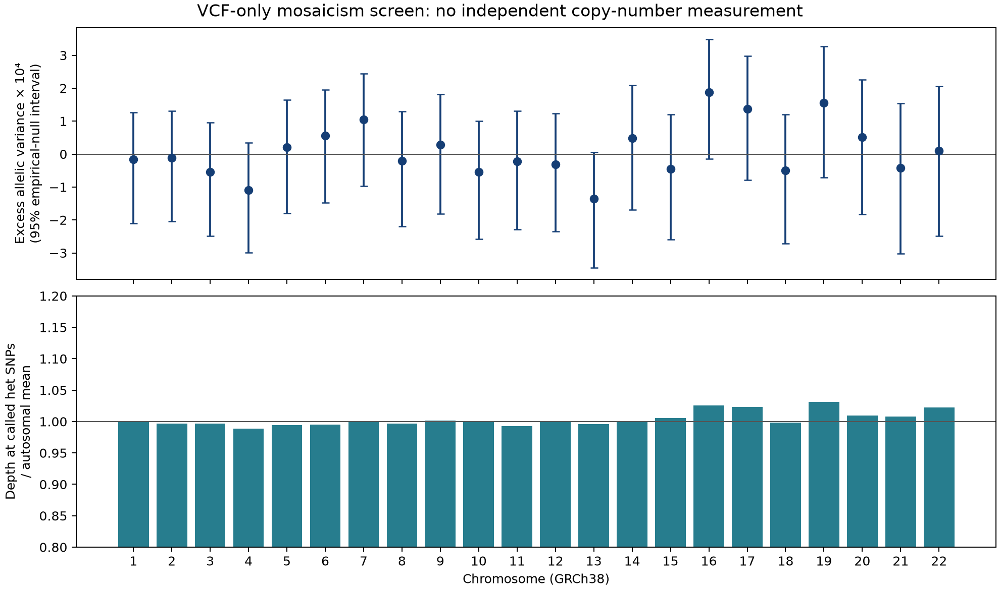
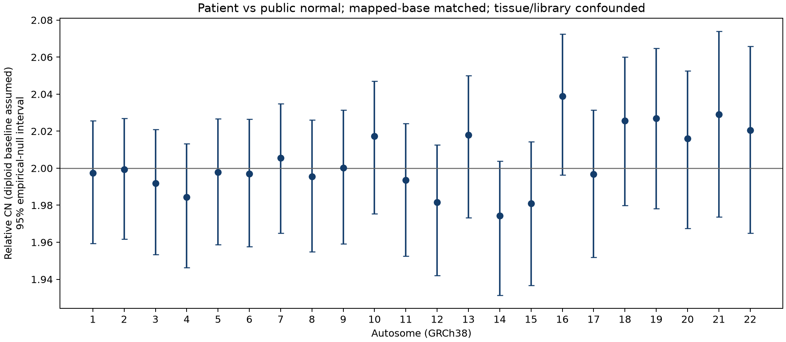
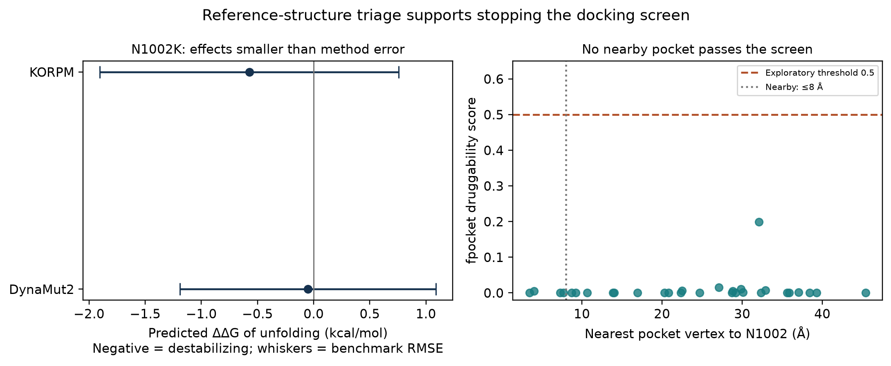

# Uridine triacetate in BUB1B-associated MVA: a metabolic rescue hypothesis with explicit tests of benefit and harm

Can relieving replication stress reduce a modifiable component of chromosome instability in BUB1B-associated MVA? We identify uridine triacetate as an approved-drug candidate for preclinical investigation and assess published rescue evidence, human exposure, and countervailing cancer biology. Existing studies demonstrate benefit from a nucleoside mixture in selected cancer models; uridine-alone sufficiency and relevance to BUB1B remain unproven. Our contribution is a reproducible evidence audit and a disease-model experiment that tests chromosome-segregation fidelity alongside DNA damage, viable proliferation, and tumor fitness. We propose laboratory evaluation with predefined rejection criteria. Rescue in MVA and clinical benefit have not yet been demonstrated. [Burrell, PMID 23446422; DOI 10.1038/nature11935](https://pmc.ncbi.nlm.nih.gov/articles/PMC4636055/); [Xuriden label, §§1, 6.1, 12.3](https://dailymed.nlm.nih.gov/dailymed/fda/fdaDrugXsl.cfm?setid=88ca4d2b-3905-474b-9fd6-c81474f2fb4b&type=display).

## Summary

Carson Olafson / carcango — Track 2, Rare Disease, Real Kid: MVA Hackathon 2026. Genome analyses retain their 24 October 2026, 18:00 UTC cutoff. The later public-literature follow-up and this packaging pass were separately authorized. No patient dose or clinical use is proposed.

**Central uncertainty: two biological transfers must hold.** (a) A meaningful share of the errors in a BUB1B model must arise from a process that nucleotide supplementation can improve. (b) Uridine alone must reproduce enough of the four-nucleoside benefit. Neither transfer has been demonstrated. A genetically corrected control establishes that the defect depends on BUB1B; it does **not** establish that replication stress is the correctable component.

**Decisive experiment:** compare uridine alone, the mixture and vehicle in exact-genotype and corrected cells. Measure nucleotide pools, errors per completed division, DNA damage and viable proliferation, with parallel RMS fitness tests. Proposed laboratory gates are at least **30% fewer division errors**, a 95% interval excluding no benefit, and at least **90% preserved viable output**. Any reproducible increase in genomic damage or tumor fitness rejects progression. These are design choices, not demonstrated effects or clinical-benefit thresholds. The full protocol below separates a failed biological premise from a failed uridine-only substitution. Supporting routes and genome-level measurements are retained in Appendices A–B; they are not evidence of uridine efficacy.

## Candidate drug: uridine triacetate

Our lead is **Xuriden**, FDA-approved for adult and pediatric hereditary orotic aciduria. Oral granules and chronic pediatric experience provide a practical approved-product precedent, not MVA efficacy or oncology safety. The label's published once-daily regimen starts at 60 mg/kg and permits escalation for inadequate efficacy; this is source context, not a dose recommendation for this child. [Official label, §§1–2](https://dailymed.nlm.nih.gov/dailymed/fda/fdaDrugXsl.cfm?setid=88ca4d2b-3905-474b-9fd6-c81474f2fb4b&type=display).

| Exposure observation / calculation | Verified value |
|---|---:|
| Day 28 plasma **uridine** peak, n=4 | 88.7 ± 43.2 µM, mean ± SD |
| Reference concentration from Burrell methods | 30 µM; not an established uridine efficacy threshold |
| Peak / reference concentration | 88.7 / 30 = **2.96**; not an efficacy margin |
| Day 28 AUC0–8 | 278.7 ± 148.5 µM·h |
| Calculated first-eight-hour average | 278.7 / 8 = **34.84 µM** |

Source: [label Table 3](https://dailymed.nlm.nih.gov/dailymed/fda/fdaDrugXsl.cfm?setid=88ca4d2b-3905-474b-9fd6-c81474f2fb4b&type=display); [reproducible arithmetic](../results/nucleoside_exposure_audit.json). The label measures uridine in µM, so no molecular-weight conversion is needed. The eight-hour average is not a daily average. A plasma peak does not establish sustained intracellular exposure, this child's PK or an effective uridine-alone concentration. The earlier Kygevvi/thymidine exposure comparison cannot exclude this formulation. The 30 µM value is a reference concentration, not an established uridine efficacy threshold. The 2.96 ratio establishes neither an efficacy margin, adequate target coverage nor a therapeutic window.

Using the Day 28 mean peak and half-life in a baseline-aware exponential gives **3.83–4.01 hours after the peak** above that reference when assumed baseline varies from 3 to 5 µM. Roughly four hours is a modeled post-peak period, not total daily time above the comparator, because the rising limb is omitted. This range varies only baseline; it is not an uncertainty interval over peak and half-life variability. No individual or intracellular exposure profile follows. [Model and full arithmetic](nucleoside_decision.md); [reproducible audit](../results/nucleoside_exposure_audit.json).

**The supplement was obtained; the single-component gap remains.** The actual 42-page publisher supplement was retrieved and examined within the 20-minute cap. Supplementary Figures 13–14 compare untreated cells with “Nucleosides”; no uridine-only or component-removal arm was found. They do not assign 0.3 versus 30 µM to the main rescue result or settle explicit per-component concentration. Thus the 45–55% effect belongs to the four-component preparation, and neither uridine-alone sufficiency nor four-component necessity is established. The published correction adds TCGA acknowledgements/accession information, not a nucleoside-method change. [Supplement, DOI 10.1038/nature11935, PDF pp13–14](https://media.springernature.com/original/springer-static/esm/art%3A10.1038%2Fnature11935/MediaObjects/41586_2013_BFnature11935_MOESM68_ESM.pdf); [correction, DOI 10.1038/nature12369](https://www.nature.com/articles/nature12369); [retrieval audit](../results/burrell_supplement_audit.md).

**Why the CIN result may not transfer:** Burrell reported no observed mitotic-checkpoint-function difference between the CIN-positive and CIN-negative groups (main text before Figure 1; Supplementary Figure 2d–i). The 18q-normal CIN-positive line **NCIH508** also showed no change in segregation-error frequency after nucleoside supplementation (main text before Figure 4; Supplementary Figure 13b,c). These are context-specific observations, not proof of checkpoint equivalence or BUB1B nonresponse. They bear directly on transfer (a): shared chromosome instability does not establish a nucleotide-responsive source of errors. [Burrell, PMID 23446422; DOI 10.1038/nature11935](https://pmc.ncbi.nlm.nih.gov/articles/PMC4636055/).

The proposed mechanism is downstream: relieve a nucleotide-responsive replication burden so fewer damaged chromosomes enter a defective division apparatus. A BubR1 acetylation-defective mouse K243R model develops replication stress, supporting plausibility without modeling this allele or demonstrating nucleoside rescue. [PMID 33955658; DOI 10.1111/febs.15912](https://febs.onlinelibrary.wiley.com/doi/full/10.1111/febs.15912). **Hypothesis; no source found** for uridine-responsive replication stress in this exact genotype. This route does not establish a mechanism for congenital nephrocalcinosis, reverse existing aneuploid clones or repair the checkpoint itself.

**Counterevidence to the metabolic transfer:** Pandey et al. (2025) found that ribonucleosides mainly raised CTP/UTP, raised dCTP modestly, and had little effect on fork speed; thymidine-containing conditions accelerated forks more strongly [16]. This was not a BUB1B, uridine-alone or segregation-rescue study. It argues against inferring useful metabolic or functional change from extracellular uridine. Our experiment therefore measures nucleotide pools and fork progression alongside division fidelity.

**The same concentration range contains a hazard.** Uridine at **10 or 30 µM** produced uracil-DNA damage/damage signaling in cancer cell lines. This overlaps attainable exposure and blocks an assumption of harmless replacement. It is not a human toxicity threshold. Full figures and exposure durations were not verified; the primary abstract supports the concentration claim. [Cao, PMID 26801745; DOI 10.1016/j.canlet.2016.01.007](https://pubmed.ncbi.nlm.nih.gov/26801745/).

There is meaningful reassurance: the label reports four patients aged 3–19 treated for at least 24 months without reported adverse reactions and negative standard genotoxicity assays. Formal long-term animal carcinogenicity studies were not performed. [Label, §§6.1 and 13.1](https://dailymed.nlm.nih.gov/dailymed/fda/fdaDrugXsl.cfm?setid=88ca4d2b-3905-474b-9fd6-c81474f2fb4b&type=display). FDA's review cites experience up to 19 years without reported neoplasia, but without a usable denominator or formal cancer-surveillance design. It did not identify treatment-related immunosuppression in the reviewed studies. Neither establishes safety in a child with constitutional genomic instability and prior cancer. [FDA pharmacology review, printed pp51–54 and 66](https://www.accessdata.fda.gov/drugsatfda_docs/nda/2015/208169Orig1s000PharmR.pdf).

Uridine can support glucose-restricted pancreatic cancer metabolism; another study found improved CD8 antitumor activity in mouse models. These contrasting contexts prevent assuming either universal tumor promotion or cancer protection. [PMID 37198494; DOI 10.1038/s41586-023-06073-w](https://www.nature.com/articles/s41586-023-06073-w); [PMID 41468885; DOI 10.1016/j.cmet.2025.11.016](https://pubmed.ncbi.nlm.nih.gov/41468885/). A recent RMS study establishes pyrimidine dependence in PAX3–FOXO1-positive models, but a uridine-alone result was not verified and this child's fusion status is unknown. [PMID 40911784; DOI 10.1158/0008-5472.CAN-25-0315](https://pubmed.ncbi.nlm.nih.gov/40911784/).

We propose no combination. Vistogard's acute fluoropyrimidine-rescue indication does not justify chronic frequent dosing; its label warns that non-emergency use can diminish fluorouracil/capecitabine efficacy. No interaction with this child's unspecified regimen is inferred. [Official Vistogard label](https://dailymed.nlm.nih.gov/dailymed/fda/fdaDrugXsl.cfm?setid=269f7363-63ed-444e-85f1-f0009e44818b&type=display).

## Variant mechanism

The official-format Track 1 CSV contains one primary pair: GRCh38 chr15:40209701 T>G, **ENST00000287598.11:c.2210T>G p.(Leu737Ter)**, and chr15:40220612 T>G, **c.3006T>G p.(Asn1002Lys)**. The sample ID comes from the VCF header, not the gated dataset README. Both calls are heterozygous, PASS and GQ99; the pair is unphased. An in-trans recessive model is compatible with the findings but is not established by parental segregation or read phasing. EPCR 0.90 is an explicitly subjective submission estimate.

The eight HPO terms rank 2,489 genes by information-weighted overlap. BUB1B starts at HPO rank 18; protein impact and recessive compatibility bring its pair to the top. Thirty-nine canonical coding models were available among the top 40 genes. Local reference-checked translation found 29 protein-altering calls. Twelve shortlisted named variants were queried through VEP; no bulk genome was transmitted. Leu737Ter has returned population frequency below 0.001; Asn1002Lys has no returned frequency, which remains unknown. This is phenotype-first discovery, not an exhaustive genome-wide annotation.

Leu737Ter occurs in exon 17 of 23. Its stop codon ends at cDNA position 2363; the final exon junction is after position 3109. The gap is **746 nt**, exceeding the 50–55 nt NMD rule. Loss of this transcript is predicted; RNA measurement is needed. BUB1B encodes BubR1, a mitotic checkpoint regulator. Biallelic dysfunction is consistent with impaired chromosome segregation and mosaic gains/losses, rather than a gain-of-function kinase disease. The gene-disease basis is supported by Hanks et al.; the NMD rule is summarized by Lejeune [1,2].

If the variants are in trans, the residual Asn1002Lys allele may impair abundance, conformation, partner interactions or checkpoint function. If they are in cis, Asn1002Lys lies downstream of the stop on the same allele; the opposite allele may be intact, and the residual-missense-protein premise must be withdrawn. An undetected lesion or alternative mechanism then needs investigation. Phase and expression remain prerequisites.

Leu737Ter retains the sequence of the N-terminal checkpoint motifs, Bub3-binding region and KARD, but removes the annotated human pseudokinase fold (766–1050). Asn1002 lies inside that fold. Retained sequence is not proof of retained function. Earlier MVA-cell work separates low BubR1 abundance from molecular dysfunction; later matched-abundance experiments show that pseudokinase defects can impair KARD phosphorylation, PP2A-B56 recruitment, alignment and checkpoint silencing. A larger western-blot band therefore does not establish rescue [R03–R07].

The often cited **mouse L1002P is human L1012P**, not human N1002K [R08, corrected by R09]. Its HSP90 dependence and allele/tissue-specific biology cannot be assigned to this variant. Conservation and high predicted structural confidence do not establish instability. Our independent stability/pocket calculations are reported in Appendix B.

There is no defensible percentage of functional BubR1 from DNA allele balance. Under explicit assumptions of no allele-A contribution, equal normal allelic expression and no compensation, function could be represented as `0.5 × residual allele-B abundance × per-molecule activity`. Neither factor has been measured. Checkpoint and attachment activities require separate assays. Increasing WT BubR1 genetically improved selected mouse outcomes [R11]; stabilizing a novel mutant is a different intervention.

The proposed disease chain is faulty checkpoint/attachment control → new chromosome errors → heterogeneous aneuploidy → context-dependent stress, arrest, senescence, cell loss or tumor evolution. This supports a fidelity endpoint. It does not establish that BUB1B explains nephrocalcinosis or the precise cause of prenatal growth restriction. No direct BUB1B-to-nephrocalcinosis mechanism was verified. A treatment might reduce new errors without removing existing aneuploid cells or reversing prenatal damage.

## Falsification and first experiments

**The experiment: a paired uridine-only rescue and harm test.** This is a proposed design, not completed work or a validated clinical-benefit threshold.

1. Use nonmalignant cells engineered with the exact two BUB1B alleles in trans, two independent clones and corrected isogenic controls. Authorized patient cells could add validation if already available. First require a division-error defect that correction reverses; otherwise the assay cannot adjudicate rescue. This establishes BUB1B dependence, not replication stress as the correctable cause. Include an external HT29 control to test the published nucleoside-responsive setting.
2. Compare vehicle, uridine alone and the four-nucleoside mixture over 48 hours. Use uridine to model the label-measured circulating analyte; adding the prodrug directly to culture would require a separate conversion check. Test defined equal-molar mixture benchmarks at 0.3 and 30 µM **per component as our experimental choices**, not a claimed exact reconstruction of the unresolved original dose assignment. Measure baseline nucleosides in medium. In separate uridine-only arms, reproduce concentration-time profiles compatible with the reported peaks and first-eight-hour AUCs, bracket the unknown overnight tail, and measure actual medium exposure. Measure intracellular UTP/CTP, all four canonical dNTPs and dUTP, including the dUTP/dTTP ratio. Measure fork progression directly with a DNA-fiber assay rather than infer replication benefit from extracellular concentration. Do not label these profiles patient-matched. A constant 30 µM arm is a mechanistic comparator, not proof of clinically feasible continuous exposure.
3. Count errors **per completed division**, blinded, distinguishing centromere-positive laggards from acentric fragments and bridges. Track viable proliferative output, arrest and cell death. Add uracil-sensitive DNA-damage measurements, such as a validated UDG-dependent assay, with γH2AX as a complementary readout. A lower abnormal-cell fraction caused by arrest or killing is not rescue.
4. Run the same measured exposure profiles in fusion-positive and fusion-negative RMS models, under nutrient-replete and glucose-restricted conditions. Measure direct cell counts and clonogenic survival through a 10–14-day follow-up; ATP alone is insufficient for a metabolic intervention. These models bracket risks and do not represent the child's unknown tumor subtype. Tumor-only cultures cannot establish immune safety.

**Prespecified laboratory gate:** select one exposure in an exploratory run, then confirm independently. Require at least **30% relative reduction in division errors**, a 95% interval excluding no benefit, and at least **90% of vehicle viable proliferative output**. Require no reproducible increase in uracil-DNA damage or adverse clonal selection. Any reproducible RMS fitness increase fails, even if smaller than 20%. Also require sufficient precision: for RMS clonogenic output, provisionally require the upper one-sided 95% confidence bound on the treated/vehicle ratio to be **below 1.20**. This 20% harmful-effect margin is a proposed screening choice that an oncologist must review, not permission for a demonstrated smaller increase or an acceptable clinical cancer-risk increase. Power from between-culture pilot variability; cells in a dish are not independent biological replicates. A wide interval is inconclusive, not a safety pass.

If the mixture works but uridine alone fails at the exposure profiles tested, the approved-product substitution fails under those tested conditions. If neither works while the external positive control does, the proposed responsive component is not demonstrated under the tested conditions. If uridine improves division fidelity while increasing DNA damage or RMS fitness, it fails the chronic-use screen. A pass justifies replication, longer exposure, relevant tissues, immune-competent cancer-risk work and clinical pharmacology review. **It does not authorize treating the child.**

## Scalable pipeline

The contribution is **a potentially novel repurposing hypothesis, a reproducible assessment of its supporting and opposing evidence, and a specific experiment that could establish or reject the proposed mechanism**. This is a novelty-qualified research claim, not a demonstration of rescue.

`mva-repurpose` installs through `uv sync`. Inputs are a gene or bounded named variants, HPO terms, mechanism direction, and optional PGx/literature evidence. Public Ensembl/UniProt/Reactome/Open Targets/ChEMBL and publication APIs are cached with provenance; no genome is required. HPO resolution is local. With a supplied gene, variants are provenance rather than allele-specific drug-effect predictors.

Mechanism link, evidence, approval proxy, pediatric evidence and PGx receive transparent review scores. The optional curated branch preserves external judgments, caps indirect evidence, reports missing causal bridges and checks product-specific approval freshness. It keeps laboratory hypotheses separate from supported rescue and clinical eligibility. The [curated replay](../examples/bub1b_curated_readme.md) preserves the historical three-drug run using public cached inputs and the local PGx table. It is not the current shortlist. Curated literature nominates uridine triacetate here; the automatic graph did not independently discover or validate its rescue mechanism. Unknown evidence remains unknown. Direct incompatible action is excluded; graph proximity stays context. Known disease-label matches remain separate from novel rescue because coarse labels lose route and manifestation. Discovery caps and omitted proteins are reported; a frozen public cache supports offline replay.

The BUB1B test checks context discovery and abstention. The positive control discovers everolimus near the top for TSC2/TSC without supplying its name. Known disease-indication data contribute to its score. EXIST-3 establishes the published clinical association [13]. This validates retrieval/indication gating, not novel prediction. A wrong-disease control removes that support. Behavioral checks also cover directionality, per-edge support, PGx identity and absent-genotype handling. Actual CLI runs supplement tests.

### Methods finding: the identifier-collision census

A public census found **13,146 distinct misassigned gene–GtoP-ligand pairs across 1,403 genes** in DGIdb's December 2024 export. That is **80.33% of its 16,365 GtoP rows**, not of all DGIdb. IUPHAR target 701 became Entrez Gene 701, falsely assigning a renal chloride-channel drug to BUB1B. The confirmed numeric-import defect was fixed upstream in April 2026; both tested 2026 exports contain zero instances of that exact substitution. The October export and live API retain **11 other identity conflicts**, with cause unresolved. [Census and named evidence](collision_audit.md); [upstream repair](https://github.com/dgidb/dgidb-v5/pull/624).

Historical errors intersect **373 assessed disease-associated genes and 512 ORPHA entities**; overlapping disorders/subtypes are not patient counts. Our engine does not ingest DGIdb. None of 7,800 comparable historical wrong gene–ChEMBL pairs overlaps the current ChEMBL mechanism collection; 331 human mechanism records lack the HGNC identity needed for that comparison. These bounded zeroes do not certify whole databases. The fix is namespaced identifiers, post-import identity checks and quarantining conflicts before scoring. A second implementation reproduced the main historical count; the public replay reproduces eight outputs from 52 hashed inputs. This strengthens evidence hygiene, not the uridine efficacy claim. [Reproduction and coverage](../results/collision_audit/README.md).

## Limitations

Uridine-alone rescue, its required concentration/duration and a chronic oncology-safe window are unknown. The retrieved supplement does not close that biological gap. Current cancer status, renal function, medicines and individual PK were not supplied. A favorable cell experiment cannot establish years-long cancer safety. No clinician has signed this report.

The diagnostic input is one variant-only VCF without parents, read-backed phase, matched tumor or invariant-site coverage; the additional analysis uses one low-pass patient lane and one unmatched public normal. Canonical-transcript scans miss splice, structural and noncoding effects. PGx observations do not resolve full star alleles. Exact ClinVar matching can miss alternate representations. Tissue source is not established by the VCF itself.

The internal mosaic null can absorb genome-wide burden. Low-pass limits depend on the clone model, chromosome exchangeability and signal preservation; one public normal cannot separate all biological and library effects. Stability predictors share uncertainty; benchmark errors are not patient-specific intervals. The transcriptomic source gate fails and the verified shRNA subset is poorly replicated; neither is a patient signature. Approval/indication fields can lag regulation or omit formulation. No pediatric MVA safety or drug-response validation was obtained; chronic Xuriden experience concerns a different disease. Pro integration preserves its citations and explicitly marks unreplicated computations, abstract-only checks and unread correction bodies. Negative screens do not prove that no useful treatment exists.

Original submission materials use CC BY 4.0 under Official Rules item 10; restricted patient data and separately licensed third-party materials are excluded. See LICENSE.md. No publication has occurred.

## AI use

Provider: **OpenAI**. Codex orchestration with explicitly selected **GPT-6.1 Sol** analysis, implementation and review agents. Plan/tier: **Pro**. **Model training and data sharing disabled**, confirmed by Carson on 23 October 2026 (America/Vancouver). No non-OpenAI models were used. A separate ChatGPT Pro literature review supplied the mechanism hypotheses and ordinal judgments; its precise model identifier was not supplied. Its handoff was received locally and independently audited before integration.

Model context contains aggregate counts and limited named findings, not genotype-scale VCF blocks. External patient-related queries were bounded named variants. Public gene/drug/reference-structure APIs supported analysis. Code ran on actual permitted inputs, with behavioral tests and independent review. Scientific responsibility remains with the entrant; clinical review is required before translation. No clinician signoff is claimed.

## References

New nucleoside claims have inline PMID/DOI links and an explicit [source audit](../results/nucleoside_source_audit.json). The [supplement audit](../results/burrell_supplement_audit.md) records the retrieved source hash and unresolved dose/single-component questions. Regulatory documents have no article PMID/DOI.

Publications were opened through PubMed/DOI or Europe PMC metadata/full text. Abstract-only access does not imply full-text review. Per-analysis artifacts record requests, hashes and access limits. The complete original **R01–R51** citation set is preserved in [Pro references](pro_references.md), with all 51 identities verified against PubMed XML and Europe PMC. R09, R20 and R22 are corrections, not independent evidence. The [mechanism/reference audit](../results/pro_reference_audit.md) and [drug-claim audit](../results/pro_drug_verification.md) state which claims were checked in full text, figures, abstracts or records. Unread correction bodies remain explicitly unverified. R-citations in this report resolve through that preserved list.

1. Hanks S et al. Biallelic BUB1B mutations and constitutional aneuploidy. *Nature Genetics* (2004). PMID **15475955**; DOI [10.1038/ng1449](https://doi.org/10.1038/ng1449). Abstract opened.
2. Lejeune F. Nonsense-Mediated mRNA Decay, a Finely Regulated Mechanism. *Biomedicines* (2022). PMID **35052820**; DOI [10.3390/biomedicines10010141](https://doi.org/10.3390/biomedicines10010141).
3. Jakubek YA et al. Mosaic chromosomal alterations in blood across ancestries using whole-genome sequencing. *Nature Genetics* (2023). PMID **37904051**; DOI [10.1038/s41588-023-01553-1](https://doi.org/10.1038/s41588-023-01553-1).
4. Birdwell KA et al. CPIC guideline for CYP3A5 genotype and tacrolimus dosing. PMID **25801146**; DOI [10.1002/cpt.113](https://doi.org/10.1002/cpt.113).
5. Cooper-DeHoff RM et al. CPIC statin pharmacogenetics guideline. PMID **35152405**; DOI [10.1002/cpt.2557](https://doi.org/10.1002/cpt.2557).
6. Lee K et al. ACMG SF v3.3. *Genetics in Medicine* (2025). PMID **40568962**; DOI [10.1016/j.gim.2025.101454](https://doi.org/10.1016/j.gim.2025.101454).
7. Rodrigues CHM et al. DynaMut2. PMID **32881105**; DOI [10.1002/pro.3942](https://doi.org/10.1002/pro.3942).
8. KORPM primary methods paper. PMID **36629451**; DOI [10.1093/bioinformatics/btad011](https://doi.org/10.1093/bioinformatics/btad011).
9. Le Guilloux V et al. Fpocket. PMID **19486540**; DOI [10.1186/1471-2105-10-168](https://doi.org/10.1186/1471-2105-10-168).
10. Evangelista JE et al. SigCom LINCS. *Nucleic Acids Research* (2022). PMID **35524556**; DOI [10.1093/nar/gkac328](https://doi.org/10.1093/nar/gkac328).
11. Clark NR et al. The characteristic direction. PMID **24650281**; DOI [10.1186/1471-2105-15-79](https://doi.org/10.1186/1471-2105-15-79).
12. Drug and Clinical Candidate Drug Data in ChEMBL. *Journal of Medicinal Chemistry* (2025). PMID **40971497**; DOI [10.1021/acs.jmedchem.5c00920](https://doi.org/10.1021/acs.jmedchem.5c00920).
13. French JA et al. EXIST-3. *Lancet* (2016). PMID **27613521**; DOI [10.1016/S0140-6736(16)31419-2](https://doi.org/10.1016/S0140-6736(16)31419-2). Abstract opened.
14. Gargano MA et al. The Human Phenotype Ontology in 2024. PMID **37953324**; DOI [10.1093/nar/gkad1005](https://doi.org/10.1093/nar/gkad1005).
15. Milacic M et al. The Reactome Pathway Knowledgebase 2024. PMID **37941124**; DOI [10.1093/nar/gkad1025](https://doi.org/10.1093/nar/gkad1025).

16. Pandey P et al. Decoding nucleoside supplementation: how thymidine outperforms ribonucleosides in accelerating mammalian replication forks. *Nucleic Acids Research* (2025). PMID **41099693**; DOI [10.1093/nar/gkaf1035](https://doi.org/10.1093/nar/gkaf1035). [Full primary paper opened](https://www.diva-portal.org/smash/get/diva2:2010300/FULLTEXT01.pdf), Figures 1 and 3. The [2026 correction, DOI 10.1093/nar/gkag532; PMID 42165140](https://pmc.ncbi.nlm.nih.gov/articles/PMC13187833/), fixes an Introduction production error about thymidine classification; no results correction is stated.

Regulatory source opened: [EMA Translarna](https://www.ema.europa.eu/en/medicines/human/EPAR/translarna). Official format, rules and acknowledgement were read from the [hackathon source](https://huggingface.co/spaces/SageBio/rare-disease-real-kid-mva-hackathon-2026/tree/main/tabs). These official documents have no PMID/DOI. The public Synapse wiki (syn76251147, wiki 642892) was opened and contains the challenge link but no exact dataset citation/DOI. The required dataset citation remains unresolved; none is invented.

## Acknowledgement

This work was made possible through the Hackathon, organized by Sage Bionetworks in partnership with the MVA Society, Hugging Face, and BEACON (The Benchmarking, Evaluation, and Assessment Consortium for Science), with prize sponsorship from AWS and Anthropic. We are deeply grateful to the child and their family who generously contributed their data and their story to advance research into this rare disease. We acknowledge their trust in making this Hackathon possible.

## Appendix A. Eight routes deprioritized under the available evidence

These analyses constrain the current proposal. Inconclusive routes are **deprioritized under the available evidence**, not biologically excluded. None is counted as uridine efficacy, and the uridine hypothesis does not require any reported result to be wrong.

| Route | Result and boundary |
|---|---|
| 1. Destabilized residual protein | DynaMut2 −0.051 and KORPM −0.573 kcal/mol; benchmark RMSE 1.14 and 1.33. No convincing support for a large stability effect; neutrality and failure of stabilization-based rescue are not established. RMSE is not a variant confidence interval. |
| 2. Structure-based rescue | 30 pockets; maximum druggability 0.199, nearest scores 0.001/0.005. Docking stopped at its exploratory gate in the modeled structures, not proof that no druggable conformation exists. |
| 3. Signature reversal | All eight CRISPR profiles fail provider checksums. Verified shRNA median rho 0.00647–0.06704; all four BH q≥0.098. No stable signature established in these data; no ranking bonus or negative drug-efficacy inference. |
| 4. Detectable bulk aneuploidy | VCF and primary low-pass screens have zero adjusted outliers. Detection limits apply only to modeled clonal event classes; total MVA burden is unknown and chr8p unconfirmed. |
| 5. Modifier/second-hit rescue | All 31 noncausal canonical protein-altering calls in the 49-gene scan have AF>0.001. Secondary screen: zero exact qualifying ClinVar matches. Bounded research screens do not exclude other modifiers or secondary findings. |
| 6. PGx tiebreaker | 36 markers, seven observed genotypes, no complete diplotypes or actionable dose rule for the earlier candidates. No uridine-triacetate dose or safety window follows. |
| 7. Matching mouse model | Mouse L1002P is human L1012P, not N1002K. No published in-vivo model of this exact genotype was verified. |
| 8. Earlier drug shortlist | Arimoclomol, azithromycin and niacin have no independent positive BUB1B rescue line. They are historical hypotheses, not current co-leads. |

For route 8, arimoclomol lacks a demonstrated useful-BubR1 bridge. Azithromycin's 0.1 µg/mL seven-day protein observation and 100 µg/mL 48-hour reporter condition differ 1,000-fold; they do not establish functional BUB1B readthrough. Niacin→NAD and NAD/SIRT2→BubR1 are separate experiments, with competing K250 regulation. The earlier full claim audit and citations remain available, including unread correction-body limits. [Drug verification](../results/pro_drug_verification.md); [azithromycin PMID 26620677; DOI 10.1007/s00109-015-1364-1](https://pubmed.ncbi.nlm.nih.gov/26620677/); [SIRT2 PMID 24825348; DOI 10.15252/embj.201386907](https://pubmed.ncbi.nlm.nih.gov/24825348/); [niacin PMID 32386566; DOI 10.1016/j.cmet.2020.04.008](https://pubmed.ncbi.nlm.nih.gov/32386566/); [K250 PMID 25285631; DOI 10.1016/j.bbrc.2014.09.128](https://pubmed.ncbi.nlm.nih.gov/25285631/). Ataluren remains excluded after EU non-renewal on 28 March 2025. [EMA decision](https://www.ema.europa.eu/en/medicines/human/EPAR/translarna).

## Appendix B. Genome-level evidence (step 2)

### Allele balance and direct copy-number measurement

The stringent VCF screen uses 1,779,707 autosomal heterozygous SNVs, mean allelic depth 44.82. A depth-corrected excess-variance statistic is compared with leave-one-chromosome spatial blocks and a between-chromosome technical-variance floor. Thirty thousand null replicates and Bonferroni correction cover 60 chromosome/arm tests. No region passes familywise 0.05.

Under a single-homolog clonal gain/loss model, expected-signal injection gives 90%-power whole-chromosome limits of **7.8–10.3% gain** and **7.3–9.3% loss**; arm limits are **8.2–11.5%** and **7.6–10.3%**. A 10-Mb block sensitivity run also finds no outlier. These are conditional planning limits, not upper confidence bounds on total aneuploid-cell burden. Heterogeneous opposing clones, genome-wide changes, genotype dropout and tissue-specific disease can escape the contrast.

The initial broader filter produced chr22 alternate-allele depletion (mean 0.47455), which disappeared under stringent mapping/strand/quality filters (0.49997). This post-observation refinement is disclosed; all four scans are retained. Called-variant depth is ascertainment-biased and cannot establish CN. The estimator is separate from published mosaic callers and does not claim their performance [3].

**Direct low-pass measurement:** the approved L001 pair and public HG00096 control were source-checksummed, paired-subsampled to approximately 1.1× input coverage, and aligned against the GRCh38 analysis set. Both final BAMs passed completion, input-count, hash, index, mapping and reference-dictionary checks. Mapped-base matching retained 2.809 billion CIGAR bases per side; filtered autosomal-bin mean depth was **0.917× patient / 0.801× normal**. The difference reflects contig/filter/library composition and is not concealed by nominal input coverage.

The prospective primary analysis uses 100-kb bins and 1-Mb blocks: 25,449 retained bins, 2,594 blocks and 61 eligible tests (22 whole chromosomes, 39 arms). **No contrast exceeds its nominal per-run familywise threshold.** Whole-chromosome relative CN spans **1.9743–2.0388**; arm CN spans **1.9735–2.0696**. The smallest adjusted p-value is **0.3192**, at chr8p. A pointwise interval excluding 2 does not establish a clone or override the multiplicity correction. Both within-region bootstrap and empirical-null 95% intervals are retained in the [aggregate tables](../results/lowpass_case_100kb_1mb_regions.csv).

Conditional single-copy-clone 90%-power limits are **7.07–12.40% gain / 7.77–12.48% loss** for whole chromosomes and **7.76–15.93% / 8.46–15.62%** for arms. They shift the corrected statistic under an exchangeable chromosome/block null. They are not clinical sensitivity or upper bounds on patient mosaicism. All 18 full-depth, half-depth and normal-self-split runs have zero adjusted outliers. These **18 analysis runs are robustness checks, not 18 biological replications**: they reuse the same patient material and one biological control. No familywise guarantee across runs is claimed. Their detection limits apply only to the modeled clonal event classes, not all forms of MVA.

A separate prespecified correction-recovery check injected 132 modeled chromosome changes into raw control depth before GC fitting: 22 autosomes, gain/loss, and 10/20/30% single-copy fractions. Recovered log2 signal ranged **88.4–102.3%**, median **99.6%**; the weakest case was chr19 loss at 10%. This measures depth-table correction/filter attenuation, not read-level or clinical detection power. It does not automatically adjust the detection limits or validate smaller fractions.

The additional proper-pair sensitivity, planned before patient depth inference, retains usable depth **0.740×/0.678×** and crosses its conditional within-run threshold at **chr8p: relative CN 2.0875, adjusted p=0.03457**. Its pointwise block-bootstrap interval is 2.0040–2.1169; the empirical-null interval is 2.0322–2.1359. The primary chr8p estimate is 2.0696 with adjusted p=0.3192. Across the six full-depth grid settings, this small elevation persists (2.0516–2.0814), but none passes adjustment. The primary normal self-split is 2.0276 (adjusted p=1). These are overlapping analyses of the same samples, not independent confirmation, and there is no correction across the full set of runs.

Existing VCF evidence does not corroborate a chr8p allele-balance outlier: 34,426 stringent heterozygous SNVs, mean alternate fraction 0.5014, adjusted p=1. Its conditional gain detection limit is approximately 10.04%, so lack of corroboration cannot exclude a smaller clone. **The chr8p contrast is unconfirmed and cannot establish a patient clone, its fraction or biological origin.** A matched, uncultured reference and orthogonal cell-level or targeted copy-number measurement would be needed before interpreting it biologically; selecting the smallest sensitivity p-value would overstate the evidence.

Public-normal tissue/library differences, overlapping-mate coverage and potential cultured-cell CN changes prevent treating HG00096 as a certified euploid matched control. Pair filtering changes mapping/library selection; a smaller p-value does not establish greater accuracy. Relative depth assumes a mostly diploid baseline and can miss opposing clones, whole-genome shifts or disease in another tissue. The result supplies a reproducible bulk-depth baseline; **total MVA-cell burden remains unmeasured**. See [executable methods](lowpass_methods.md) and [all results](../results/lowpass_methods.md). Approved FASTQs were removed only after validated BAM QC; the original VCF, index and clinical document remained unchanged by hash, size and mtime.

### Modifiers, PGx and secondary findings

The 49-gene checkpoint/CIN, rhabdomyosarcoma and nephrocalcinosis panel contains 33 canonical protein-altering calls, including two BUB1B retrieval controls. All 31 other calls have returned population AF>0.001; no rare canonical coding modifier is found within this panel and filter. Frequency sources include local legacy ExAC/1000G fields in ClinVar, bounded VEP annotation and one gene-only gnomAD query. This does not test somatic tumor second hits, fusions, CNVs, noncanonical transcripts or modifier enrichment.

The PGx screen evaluates 36 predefined markers in 12 genes and observes seven QC-passing genotypes. No complete star diplotype is assigned and no actionable dose rule follows for the candidates, including uridine triacetate. Individual marker genotypes are withheld from this public repository to protect the child's privacy. Missing records in a variant-only VCF are unknown, never homozygous reference. Tacrolimus/CYP3A5 guidance must not be transferred to sirolimus or everolimus [4,5]. No guideline is not a safety pass.

All 84 ACMG SF v3.3 genes were screened against 25,309 public ClinVar alleles with at least two-star P/LP evidence and no aggregate conflict. There are **zero exact QC-passing matches**. This is a limited research screen, not a negative clinical secondary-findings analysis: normalization differences, novel variants, SV/CNV and gene-specific return rules remain outside or require review [6]. No clinical findings were returned to the family.

### Structural and transcriptional moonshots

AlphaFold v6 models N1002 with pLDDT 91.06. Human experimental constructs 6TLJ/5KHU lack actual C-terminal coordinates; fly C-terminal structures are homolog references, not experimental human N1002 validation. DynaMut2 gives **−0.051 kcal/mol** and KORPM **−0.573 kcal/mol**, with unfolding convention negative=destabilizing. Benchmark RMSEs are 1.14 and 1.33 kcal/mol, performance statistics across benchmark sets rather than confidence intervals for this variant. The predictors give no convincing support for a large stability effect; they do not establish neutrality or exclude stabilization-based rescue. The methods share the predicted structure and may share training data. KORPM reproduces three published software examples exactly [7,8].

Eighteen other C-terminal Asn→Lys changes form a small within-protein comparator set; N1002K has background tail rank 1/19, not a pathogenicity p-value. Thirty fpocket domain pockets yield a maximum druggability score 0.199. The two nearest score 0.001 and 0.005. The exploratory requirement of a strong two-method stability effect plus a nearby pocket score>=0.5 fails. Docking is deprioritized under the available evidence; no library or weak pose ranking is presented as evidence. This search does not exclude ligandable pockets in other conformations or rescue mechanisms [9].

The initial SigCom LINCS computation used 21 BUB1B shRNA and eight CRISPR profiles at 96 hours in four cancer cell lines, 977 non-target landmark genes and 1,262 drug-consensus profiles [10–12]. A subsequent provenance audit found **all eight CRISPR vectors fail advertised SHA-256/MD5**, while the drug-consensus library supplies no usable advertised checksums. Fresh HTTP samples match cached bytes and S3 ETags, excluding simple transport corruption; the cause of the metadata disagreement remains unresolved. The pipeline now stops before cross-modality inference or drug permutations when this source gate fails.

Historical correlations and 4,999-permutation outputs are retained with `uninformative_quality_failure` and ranking bonus zero. They are not a validated negative screen or evidence against readthrough/protein stabilization. The Pro run used a different 125-profile chemical cohort and reported a similar hash discrepancy; a fresh independent 14-profile sample reproduced the discrepancy. The two cohorts are not pooled.

The checksum-verified shRNA subset still permits a separate reproducibility diagnostic: within-cell median pairwise rho is **0.00647–0.06704**, with all four BH q>=0.098 against 999 matched-cell whole-profile null resamples. These data do not establish a stable BUB1B-loss signature. See the [source reconciliation](../results/pro_signature_reconciliation.md) for exact hashes, access gaps and the distinction between absent metadata and contradictory metadata.
