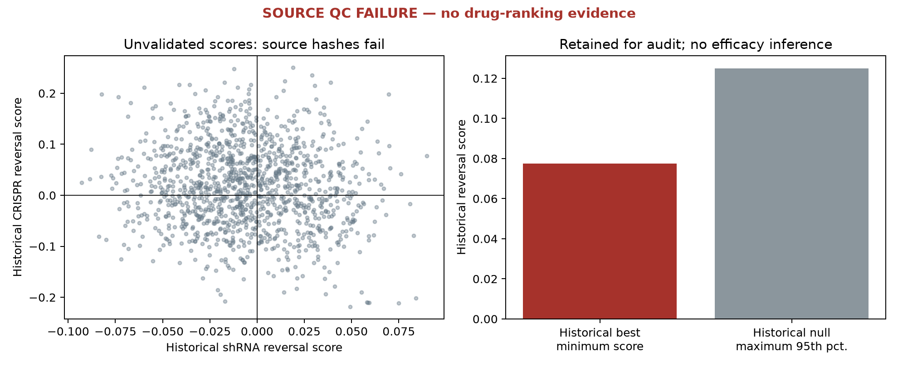

# BUB1B signature reversal: uninformative after source-quality failure

## Result

**Source audit supersedes the original interpretation. Status: `uninformative_quality_failure`; ranking bonus: 0.** All eight CRISPR files disagree with the provider's advertised SHA-256 and MD5. The 2022 drug-consensus library advertises no usable hashes (blank SHA-256, zero byte counts), so it has locally reproducible bytes but unavailable upstream checksum provenance. The correlations, p-values and ranking below are retained as **unvalidated historical diagnostics**, not a validated negative efficacy or rescue result. See [the reconciliation](pro_signature_reconciliation.md) and `signature_source_qc.json`. The CLI now stops at this source gate before cross-modality correlations or drug permutations.

The available data do not support a validated approved-drug reversal analysis of BUB1B loss. They must not supply a positive or negative efficacy claim in the treatment ranking.

The screen analyzed **1,262 drug consensus profiles** matched uniquely to ChEMBL molecules with `max_phase = 4` and `withdrawn_flag = false`. Of 1,263 eligible public profiles, one could not be downloaded (butorphanol-(+)-tartrate, HTTP 403). Drug eligibility here is a database screen; a current jurisdiction, formulation and indication must still be verified before a candidate advances.

The disease surrogate used **21 BUB1B shRNA profiles and 8 CRISPR-knockout profiles**, all at **96 hours**, in **A375, A549, MCF7 and PC3**. These are transformed cell lines. There are no patient transcriptomes in this analysis. The calculation used the **977 measured L1000 landmark genes other than BUB1B**; inferred genes were excluded to avoid apparent replication from expression imputation. BUB1B itself is a measured landmark, and was excluded from similarity scores to avoid direct target-expression leakage.

The shRNA and CRISPR consensus signatures had **Spearman rho = −0.0337719**. Same-cell cross-modality correlations ranged from **−0.0187558 to +0.0198565**. Restricting profiles to a negative BUB1B characteristic-direction coefficient did not restore agreement: **rho = −0.0319924**. These numbers cannot establish cross-modality biological concordance because the CRISPR source-provenance gate failed. Separately, provider-verified shRNA profiles show weak within-cell reproducibility; the reconciliation reports that valid diagnostic.

There were **0 drugs with BH q < 0.05** and **0 drugs with maxT familywise p < 0.05**, using 4,999 null resamples. The strongest raw two-modality reversal was indoramin: rho **0.089855** against shRNA and **0.077494** against CRISPR, with **familywise p = 0.9966**. The 95th percentile of the null maximum reversal was **0.125030**; the observed conservative score was **0.077494**. These unvalidated outputs cannot establish an effective or ineffective treatment. They earn no ranking support for indoramin or another drug.



## Historical method (source quality did not pass)

1. Query the SigCom LINCS metadata API for BUB1B perturbations and chemical consensus profiles. The returned metadata contains 89 shRNA, 31 individual CRISPR, 18 overexpression and one CRISPR consensus signature for BUB1B across all conditions. Only the preselected four cell lines and 96-hour shRNA/CRISPR conditions enter this screen. Overexpression profiles are not substituted for loss of function.
2. Retrieve ChEMBL phase-4 molecules, preferred names, synonyms and withdrawal flags. Normalize punctuation and case, require an exact unique name/synonym match, and exclude positive or missing withdrawal flags. No salt-stripping or fuzzy identity guesses are made. Of 33,608 chemical consensus metadata records, 1,263 matched these rules.
3. Retrieve only individual public expression vectors, approximately 100–350 KB each. The full chemical matrix is not downloaded. No patient data, genome coordinates or phenotypes are transmitted.
4. Within each genetic perturbation profile, rank the 977 non-target landmark coefficients and normalize the centered rank vector. Average profiles within cell line, weight the four cell lines equally, and rank again to form one consensus per genetic modality. Correlate each drug consensus vector with each genetic consensus. A positive reversal score is the negative Spearman correlation.
5. Rank drugs by the **smaller** of their shRNA and CRISPR reversal scores, so one genetic modality cannot drive the discovery statistic.
6. Draw 100 unrelated landmark gene targets without replacement with seed **20261024**. Retrieve their shRNA profiles in the same cell lines at 96 hours. There are 95, 97, 85 and 85 available target/cell groups, respectively. Average up to three profiles per target/cell group, ordered by public signature ID. This limits over-weighting of more extensively profiled control genes.
7. For each of **4,999 resamples**, independently replace the BUB1B shRNA vector within each cell line with a complete unrelated-target vector from that cell. Average the four vectors as for BUB1B and recompute all drug correlations. Whole-vector sampling preserves gene covariance within cell profiles; it avoids treating correlated landmark genes as independent permutation units. This is a **competitive gene-specificity null**, rather than a null of no treatment effect. Cell-wise target combinations need not correspond to one biological gene perturbation.
8. Compare the conservative observed score to the resampled shRNA scores. These comparisons are conservative relative to the shRNA-only observed score because the observed score cannot exceed it. Apply BH across all 1,262 drugs. Also compare each observed score to the **maximum** across drugs in each resample (maxT). The plus-one empirical p-value resolution is **0.0002**.
9. As a sensitivity check, compare to 81 unrelated control targets represented in all four cell lines, preserving a coherent target across cells. Their coarser historical competitive p-values are retained in the diagnostics for the top ten drugs. They do not resolve the failed source-provenance gate.

The raw ranking, including nonpositive reversal scores, is in `signature_ranked_approved_drugs.csv`. Its top ten are exploratory ranking artifacts:

| Raw rank | Drug name | shRNA reversal rho | CRISPR reversal rho | Familywise p |
|---:|---|---:|---:|---:|
| 1 | Indoramin | 0.089855 | 0.077494 | 0.9966 |
| 2 | Propofol | 0.069954 | 0.096920 | 1.0000 |
| 3 | Orphenadrine | 0.069633 | 0.197696 | 1.0000 |
| 4 | Rifaximin | 0.064303 | 0.082912 | 1.0000 |
| 5 | Iodipamide (LINCS: adipiodone) | 0.063598 | 0.105900 | 1.0000 |
| 6 | Colistin | 0.058278 | 0.144758 | 1.0000 |
| 7 | Megestrol acetate | 0.055513 | 0.130267 | 1.0000 |
| 8 | Tirbanibulin (LINCS: KX-2391) | 0.054665 | 0.084632 | 1.0000 |
| 9 | Testosterone enanthate | 0.070448 | 0.053318 | 1.0000 |
| 10 | Guanadrel | 0.052950 | 0.112170 | 1.0000 |

## Limits and what would change the conclusion

- LINCS cancer lines, acute knockdown/knockout, and consensus profiles are imperfect surrogates for lifelong biallelic BUB1B dysfunction. shRNA and CRISPR have different perturbation artifacts. Neither models the exact Leu737Ter/Asn1002Lys pair.
- The chemical consensus data pool cell lines, doses and exposure times. A pooled reversal cannot establish a clinically attainable concentration, a favorable response in relevant tissue, or a direction of effect on chromosome missegregation. No pediatric dose or safety conclusion is made.
- Provider-verified shRNA profiles show a negative BUB1B characteristic-direction coefficient in 12/21 cases. The historical 7/8 CRISPR count is unvalidated because of the hash failures. These coefficients are not knockdown-efficiency measurements or fold changes. Weak or heterogeneous perturbations, or unresolved provenance, may affect concordance.
- The unrelated-target null preserves covariance within each complete expression vector and matches cell line and time. It does not eliminate batch effects, shRNA off-target effects, differences in replicate counts, or gene-target selection bias. Null targets are sampled from landmark genes, not the complete genome. Its p-values assess specificity relative to these controls and must not be read as efficacy probabilities.
- Failure of source provenance and poor shRNA reproducibility do not show that approved drugs cannot correct MVA. This public transcriptomic route supplied no defensible positive or negative treatment evidence.
- A stronger next test would generate transcriptomes and direct chromosome-instability measurements in patient-derived and isogenic corrected cells, verify BUB1B suppression/rescue, and require a drug to reduce missegregation without merely stopping proliferation. That would test the disease phenotype and the transcriptional surrogate together.

## Run and audit

```bash
UV_CACHE_DIR=work/.uv-cache uv run python -m mva_hackathon_2026.signature \
  --cache work/signature --output results --permutations 4999 \
  --control-genes 100 --workers 6 --seed 20261024
```

After the public responses have been cached, use `--offline` to forbid network access and reproduce the source audit. The default command now returns `uninformative_quality_failure` before the drug calculation because advertised CRISPR hashes conflict with cached bytes; the original unvalidated outputs remain for audit. Cache files remain in ignored `work/signature/`; they contain public data only. SHA-256 hashes and byte counts are in `signature_public_cache_manifest.json`. Successful newly fetched responses have `.source.json` files with the exact URL, request and retrieval time. Public metadata collected during initial exploration predate those sidecars; their hashes are still recorded and their query construction is in the module. The one unavailable signature is explicitly recorded in the cache. An uncached future run may see updated ChEMBL curation; retain the cache to reproduce this exact screen.

The independently provider-verified shRNA-only reproducibility diagnostic is available with `--offline --shrna-qc`; its results and matched-profile null are in [the reconciliation](pro_signature_reconciliation.md).

## Opened sources

- Evangelista JE et al. **SigCom LINCS: data and metadata search engine for a million gene expression signatures.** *Nucleic Acids Research* (2022). **PMID: 35524556; DOI: 10.1093/nar/gkac328.** [Primary full text](https://www.ebi.ac.uk/europepmc/webservices/rest/PMC9252724/fullTextXML), opened and read on 2026-10-24 UTC. It supports the public signature resource and the measured/inferred gene distinction.
- Clark NR et al. **The characteristic direction: a geometrical approach to identify differentially expressed genes.** *BMC Bioinformatics* (2014). **PMID: 24650281; DOI: 10.1186/1471-2105-15-79.** [Primary full text](https://www.ebi.ac.uk/europepmc/webservices/rest/PMC4000056/fullTextXML), opened and read on 2026-10-24 UTC. This is the upstream signature method; the present reversal and null calculations are implemented here.
- **Drug and Clinical Candidate Drug Data in ChEMBL.** *Journal of Medicinal Chemistry* (2025). **PMID: 40971497; DOI: 10.1021/acs.jmedchem.5c00920.** [Primary full text](https://www.ebi.ac.uk/europepmc/webservices/rest/PMC12516679/fullTextXML), opened and read on 2026-10-24 UTC. ChEMBL phase 4 includes previously approved/withdrawn drugs; the additional withdrawal filter is deliberate. A false withdrawal flag does not verify a current local product license.
- [SigCom LINCS official API tutorial](https://maayanlab.cloud/sigcom-lincs/static/tutorial/ldp3/LDP3Tutorial.html) and [ChEMBL official drug/compound documentation](https://chembl.gitbook.io/chembl-interface-documentation/frequently-asked-questions/drug-and-compound-questions), opened on 2026-10-24 UTC. These are software/data documentation rather than literature citations.
