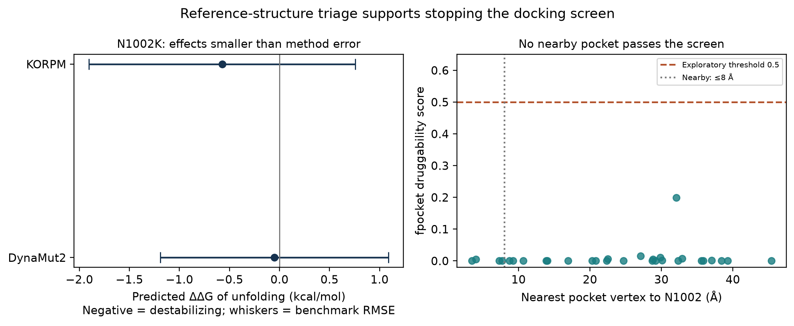

# Structural rescue triage: BUB1B p.Asn1002Lys

## Decision

**Stop the proposed corrector-docking screen.** Two complementary stability methods return effects smaller than their published benchmark errors. No nearby pocket passes the declared exploratory druggability threshold. The predictors give no convincing support for a large stability effect. Benchmark RMSE is a performance statistic across a benchmark set, not a confidence interval for this variant. These results neither establish neutrality nor exclude stabilization-based rescue. Docking is deprioritized under the available evidence, not ruled out for all possible conformations.

No drug library was downloaded, no docking was performed, and no docking hits are reported. This follows the requested gate: proceed only when the variant is convincingly destabilizing and a suitable nearby pocket exists.

## Reference and experimental coverage

The public reference is human BubR1/BUB1B, UniProt O60566, 1,050 residues; AlphaFold DB AF-O60566-F1, version 6, model date 2025-08-01. Asn1002 has pLDDT **91.06**. The mean for residues 705–1050 is **79.96**. Thus, the local fold is confidently predicted; lack of local model confidence is not a reason to stop. AlphaFold confidence is not evidence that the mutant folds normally, that a pocket binds a drug, or that a ligand rescues checkpoint function. The model method is described by Jumper et al. [PMID:34265844; DOI:10.1038/s41586-021-03819-2](https://www.ebi.ac.uk/europepmc/webservices/rest/PMC8371605/fullTextXML).

The UniProt/PDBe records include two full-length experimental constructs, 6TLJ chain S and 5KHU chain Q. Their **actual ATOM coordinates** cover only 293 residues within 19–345 and 219 residues within 18–308, respectively. Neither models residue 1002 or any residue in 705–1050. A construct sequence reaching residue 1050 must not be mistaken for experimental validation of the C-terminal fold. All nine PDB cross references listed in the retrieved UniProt record were inspected; the remaining mapped constructs cover N-terminal fragments or the 647–720 PP2A-binding region. Their metadata provide no experimental C-terminal validation.

Experimental C-terminal homologs were also retrieved: **Drosophila** BubR1 apo structure **6JKK** (1.85 Å) and ADP complex **6JKM** (1.95 Å). UniProt maps each construct to 1127–1460; the deposited author coordinates number the 334 modeled residues as 1126–1459. Their structures and primary-paper metadata were opened directly through RCSB. They provide experimental homolog references, but they do not experimentally resolve human Asn1002. No human-to-fly residue mapping or rescue-pocket transfer is claimed. The primary paper is Huang et al., PMID:31201382, DOI:10.1038/s41422-019-0178-z; its PubMed/DOI metadata and abstract were verified, while direct full-text XML retrieval returned HTTP 500.

The reference N1002 solvent-accessible area is **27.73 Ų**, calculated with a deterministic 960-point Shrake–Rupley construction, Bondi radii and a 1.4 Å water probe. This is a geometry descriptor, not an energy estimate. In the reference, the N1002 side chain has close donor/acceptor distances to the W978 backbone: ND2–O **2.948 Å**, OD1–N **2.825 Å**. DynaMut2 returned a lysine side-chain model that loses these specific contacts. That single rotamer is not an experimentally resolved conformation or a binding-affinity measurement.

## Two actual stability estimates

Both values use **ΔΔG = ΔG(unfolding, mutant) − ΔG(unfolding, WT)**. A negative number indicates predicted destabilization. This sign convention is the reverse of the folding convention often used elsewhere.

| Method | N1002K ΔΔG, kcal/mol | Published benchmark error | Meaning |
|---|---:|---:|---|
| DynaMut2 | −0.051 | Independent S611 test RMSE 1.14 kcal/mol | Small point prediction; benchmark RMSE is not variant uncertainty |
| KORPM | −0.573 | Balanced Ssym test RMSE 1.33 kcal/mol | Modest predicted effect, smaller than benchmark error |

DynaMut2 was run through its public API using only the public WT AlphaFold reference and the named substitution N1002K. Its job completed; the raw response and job identifier are preserved in `structure_api_evidence.json`. It also returned WT and mutant coordinates, retained in ignored `work/structure/`. DynaMut2 combines normal modes and learned graph/environment features. Its S611 error comes from the full primary paper, not its more favorable cross-validation result. [PMID:32881105; DOI:10.1002/pro.3942](https://pubmed.ncbi.nlm.nih.gov/32881105/).

KORPM was compiled and run locally from the authors' pinned source. It uses a residue-based orientational statistical potential with 12 fitted amino-acid weights. The local build reproduces all three upstream example scores exactly at published precision: **−1.396, +0.108 and −0.727 kcal/mol**. This verifies execution of the released model; it does not validate N1002K experimentally. [PMID:36629451; DOI:10.1093/bioinformatics/btad011](https://pubmed.ncbi.nlm.nih.gov/36629451/).

The methods differ substantially, but their errors are not statistically independent: both use the same predicted reference structure, and their development data may overlap. Benchmark RMSEs are population error summaries, **not variant-specific confidence intervals**. Averaging the two values would not produce a validated case-specific estimate.

### Null calibration and controls

KORPM scored the same Asn→Lys change at all **18 other Asn residues** in 705–1050. Their median is **+0.1555 kcal/mol**. N1002K is more destabilizing than these 18 comparators, giving an add-one background tail rank of **1/19 = 0.0526**. This small within-protein background is not a clinical null, does not control pathogenicity error, and includes sites with different exposure and confidence. It must not be reported as proof of disease causality.

Controls help interpret magnitude: N1002N gives **0.000**; N1002Q **−0.653**; N1002A **−0.646**; and the deliberately disruptive L1012P gives **−3.227 kcal/mol**. This small point prediction gives no convincing support for a large stability effect; the benchmark error does not establish neutrality. Conservative N1002Q is predicted slightly more destabilizing than N1002K, which further cautions against translating its score into a specific lysine-rescue mechanism.

## Pocket mapping

Fpocket was run with default pocket parameters on both the full WT model and residues 705–1050. B factors were set to a constant 20 before the pocket run so that AlphaFold pLDDT could not be misread as experimental thermal displacement. Confidence analysis uses the unchanged original PDB. Time-based random seeds in the public source were fixed to **20261023** for reproducible Monte Carlo volume estimates; pocket-scoring equations and coefficients were unchanged. [PMID:19486540; DOI:10.1186/1471-2105-10-168](https://doi.org/10.1186/1471-2105-10-168).

The C-terminal fragment yields **30 pockets**. The nearest pocket has druggability score **0.001**, with a closest alpha-sphere center **3.459 Å** from an N1002 heavy atom. The next has score **0.005** at **4.039 Å**. The highest score anywhere in the domain is **0.199**, below the exploratory threshold **0.5** described in the software documentation. No pocket within 8 Å reaches 0.5. The full-model sensitivity run also yields no nearby qualifying pocket. Pocket scores are model descriptors, not observed binding affinities. A failed threshold in these structures does not exclude a druggable pocket in another conformation.

The declared screen requires both methods below −1.5 kcal/mol and a pocket within 8 Å with fpocket druggability at least 0.5. These are conservative screening heuristics, not validated clinical cutoffs. **Both conditions fail.** Their failure is far from the selected boundaries, so routine threshold adjustment would not justify a rescue claim.



Figure: predictions are shown with one published benchmark RMSE on either side for scale; whiskers are not confidence intervals. Pocket mapping is from the public WT C-terminal fragment.

## What this changes experimentally

A structure-based pharmacological-chaperone claim is currently weak. The first experiments should measure N1002K protein abundance/turnover, thermostability, checkpoint function, and CENP-E/PP2A-associated behavior relative to WT and an expression-matched loss-of-function control. A loss of partner interaction can occur without a large folding-energy change. The known C-terminal requirement for CENP-E binding supports testing this interaction, but it does not identify N1002 as an experimentally established contact site. [PMID:32665320; DOI:10.1242/jcs.246025](https://pmc.ncbi.nlm.nih.gov/articles/PMC7473641/).

No drug receives an additional independent efficacy line from this analysis. The result instead deprioritizes an unsupported docking route under the available evidence and makes the proposed first experiments more discriminating.

## Reproduction

The analysis module never reads patient data. All downloaded files are public references or method code. Tool files, structures, modeled mutants and intermediate predictions remain in ignored `work/structure/`. JSON results contain summaries and the single named target only, plus reference-protein calibration summaries.

```bash
# Fetch small public references; build pinned tools under ~/.agents/bin/build-lock.
# About 0.36 GB of public downloads (up to 0.7 GB if LFS needs a separate fetch).
# Each file is below 1 GB. Allow roughly 1.5 GB working disk.
UV_CACHE_DIR=work/.uv-cache MPLCONFIGDIR=work/structure/.mpl \
  uv run python -m mva_hackathon_2026.structure \
  --fetch --prepare-tools --submit-dynamut \
  --figure results/structure_screen.png

# DynaMut2 is asynchronous. Poll the existing job, without submitting a duplicate.
UV_CACHE_DIR=work/.uv-cache MPLCONFIGDIR=work/structure/.mpl \
  uv run python -m mva_hackathon_2026.structure --poll-dynamut \
  --figure results/structure_screen.png

# Reconstruct the summary offline from cached references, scores and pockets.
UV_CACHE_DIR=work/.uv-cache MPLCONFIGDIR=work/structure/.mpl \
  uv run python -m mva_hackathon_2026.structure \
  --figure results/structure_screen.png
```

Pinned software: fpocket `4bb0d8447f62fee77e2c3c29f54b5fcaf5e2c066`; KORPM `c9a50da5bbe885bdc1e6ec8c732eb914c78a0ead`. Upstream build repairs disable an unused density-map feature, use the actual produced PDB library name, remove obsolete ARM64 profiling flags, and add the Qhull include path. None modifies KORPM scoring. The executable build was verified on macOS ARM64; other platforms are not verified.

`structure_api_evidence.json` records the original completed DynaMut2 response, source URLs, KORPM potential checksum and upstream-example validation. `structure_summary.json` records input checksums, coordinate coverage, both estimates, comparator-null summaries and pocket metrics. The first DDGun server attempt returned HTTP 500; it supplied no usable prediction and was not counted as a method.
